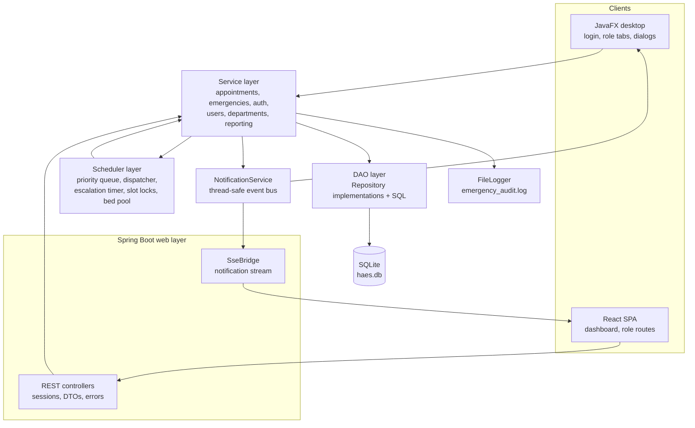
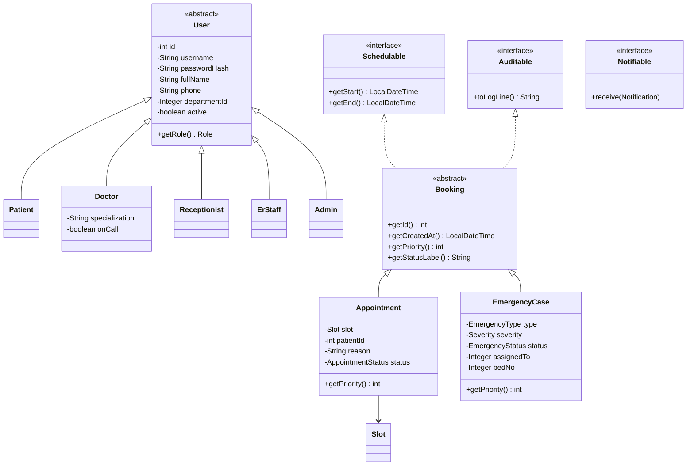
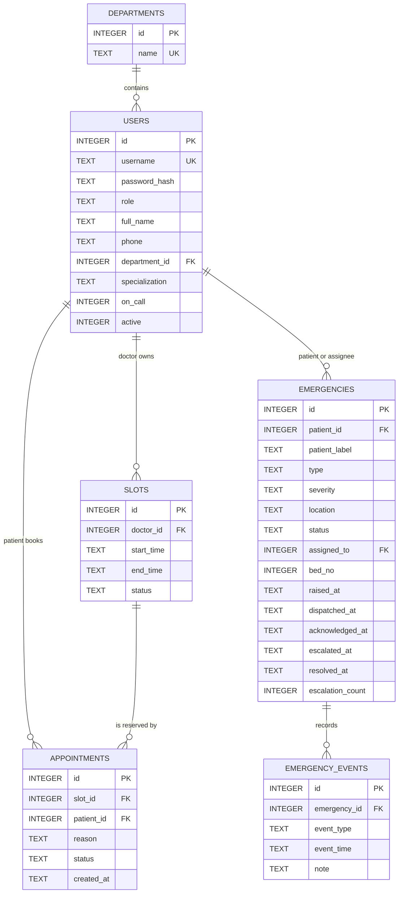
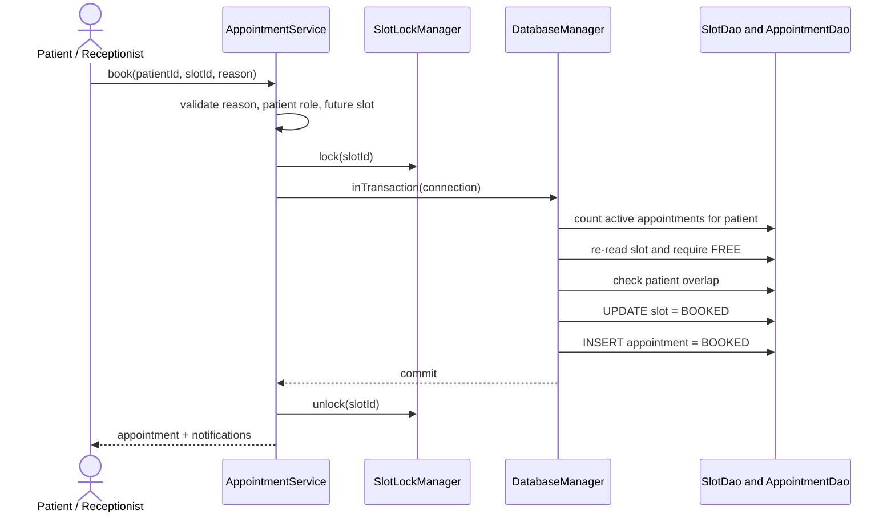
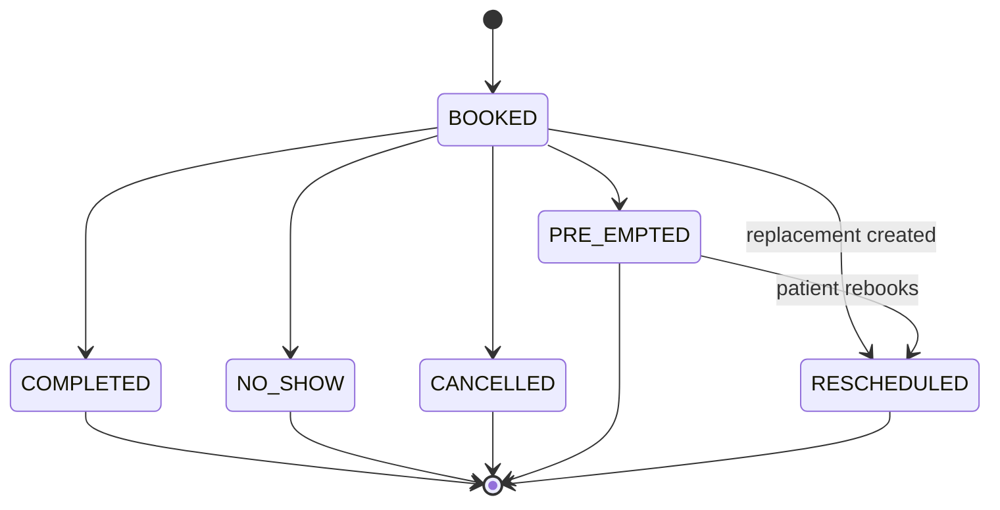
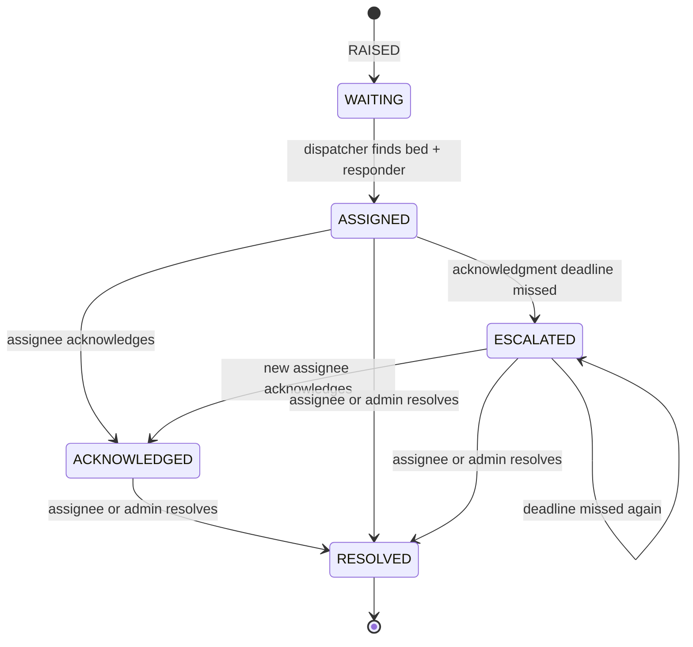

# HAES — Hospital Appointment & Emergency Scheduler

**CSE 213 Integrated Java Project**  
Java 17+ · JavaFX 21 · Spring Boot 3.5 · SQLite · React 19 · JUnit 5

**Repository:** [github.com/mevarx/JAVA-End-sem-project](https://github.com/mevarx/JAVA-End-sem-project)

HAES simulates the two scheduling problems a hospital handles at the same time:

- **Planned care:** patients book outpatient slots with doctors. A slot must never hold two appointments.
- **Unplanned care:** emergencies arrive at any moment, must be ranked by severity, and must reach a doctor, ER staff member and bed quickly.

The project shows how one domain layer can serve a **JavaFX desktop client** and a **React web client** without duplicating business rules. Concurrency, transactions, priority queues, background threads, escalation, pre-emption and audit logging are implemented in the shared Java service layer; both clients are presentation layers over it.

> **Academic simulation only.** All people, accounts and clinical records are invented. HAES stores no real patient identifiers and provides no diagnosis, clinical decision support, billing or real notification service.

## At a Glance

| Item | Value |
| --- | --- |
| Course | CSE 213 Integrated Java Project |
| Language / target | Java 17 (`maven.compiler.release=17`), verified on JDK 21 |
| Desktop client | JavaFX 21.0.5, role-specific tabs |
| Web client | React 19, TypeScript 5.9, Vite 8, Tailwind CSS 4 |
| HTTP layer | Spring Boot 3.5.16, REST + Server-Sent Events |
| Database | SQLite via `sqlite-jdbc` 3.45.3.0 |
| Concurrency | `ReentrantLock`, `PriorityBlockingQueue`, `Semaphore`, scheduled daemon threads |
| Build | Maven Wrapper 3.9.9 (no local Maven required) |
| Tests | **84 JUnit 5 tests** (67 core + 17 web), 0 failures |
| Measured evidence | 50-way booking race: exactly 1 winner; dispatch: max 99 ms against a 1,000 ms target |

## Contents

- [1. What the system does](#1-what-the-system-does)
- [2. Roles and permissions](#2-roles-and-permissions)
- [3. Quick start](#3-quick-start)
- [4. Ten-minute demonstration](#4-ten-minute-demonstration)
- [5. Architecture](#5-architecture)
- [6. Domain model and database](#6-domain-model-and-database)
- [7. Appointment scheduling](#7-appointment-scheduling)
- [8. Emergency handling](#8-emergency-handling)
- [9. Web API and client](#9-web-api-and-client)
- [10. Reports, CSV and audit log](#10-reports-csv-and-audit-log)
- [11. Testing and measured evidence](#11-testing-and-measured-evidence)
- [12. Project structure](#12-project-structure)
- [13. Configuration, reset and troubleshooting](#13-configuration-reset-and-troubleshooting)
- [14. Limitations and academic integrity](#14-limitations-and-academic-integrity)
- [15. Documentation map](#15-documentation-map)

---

## 1. What the system does

A small example of the interaction the project is built around:

1. Anita books a 09:30 slot with Dr. Sharma. The slot is locked, re-read inside a database transaction, marked `BOOKED`, and one appointment row is inserted.
2. A second patient tries the same slot at the same moment. The transaction re-check sees `BOOKED` and throws `SlotConflictException`; nothing is written.
3. While Dr. Sharma is in a routine consultation, a **Critical** cardiac emergency arrives and every free cardiologist is busy. The dispatcher may pre-empt that consultation: the appointment becomes `PRE_EMPTED`, its slot is freed, the patient is told to rebook, and Dr. Sharma is assigned to the emergency with a bed.
4. Every step is written to the emergency event table and the append-only audit log. If the responder does not acknowledge within 30 seconds, the escalation scan reassigns the case to another free responder and records the escalation.

Core guarantees:

| Guarantee | How it is achieved | Evidence |
| --- | --- | --- |
| One slot holds at most one active appointment | Per-slot fair `ReentrantLock` + transaction that re-reads the slot | `ConcurrentBookingTest`, `EvaluationTest` |
| A patient cannot hoard or overlap appointments | Active-appointment limit (3) and overlap check inside the same transaction | `AppointmentServiceTest` |
| Emergencies are handled by severity, then arrival time | `PriorityBlockingQueue` ordered by `EmergencyCase.compareTo` | `EmergencyServiceTest.priorityOrderIsRespected` |
| A bed or responder is never assigned twice | Semaphore + bed-number queue; busy-responder query | `BedPoolTest`, `EmergencyServiceTest` |
| Unacknowledged cases escalate | 1-second scan against a 30-second acknowledgment deadline | `EmergencyServiceTest` escalation tests |
| Critical cases may interrupt routine care | Pre-emption only when severity is `CRITICAL` and no responder is free | `EmergencyServiceTest.criticalPreemptsInProgressAppointment` |
| Every emergency event is timestamped | `emergency_events` table + `emergency_audit.log` | `raisePersistsCaseAndAuditTrail`, lifecycle tests |
| Role boundaries are enforced | UI tab selection, `@RequireRole` on endpoints, row-level checks in services | `RoleAccessTest`, service authorization tests |

Feature summary:

| Area | Behaviour |
| --- | --- |
| Accounts | Login, patient self-registration, password change, admin user CRUD |
| Availability | Doctors define future, non-overlapping slots; free slots can be removed |
| Booking | Patients and receptionists book free slots; conflict, overlap and active-limit rules are enforced |
| Appointments | View, filter, reschedule, cancel, complete, no-show, re-book pre-empted cases |
| Emergencies | Raise by type, severity and location; priority dispatch; bed assignment; acknowledge; resolve; escalate |
| Notifications | In-app feed and web SSE stream for confirmations, cancellations, pre-emption, dispatch and escalation |
| Reports | Appointment and emergency CSV export; availability CSV import; audit-log viewer |
| Administration | Departments, users, role validation, doctor specialization and on-call state |

---

## 2. Roles and permissions

Five roles exist in the domain model. Both clients show only the workspace for the signed-in role.

| Role | Can do | Desktop tabs | Web routes |
| --- | --- | --- | --- |
| **Patient** | Register, book own appointments, view/cancel/reschedule own appointments, raise and follow own emergencies | Book appointment, My appointments, My emergencies | `/dashboard`, `/book`, `/appointments`, `/emergencies` |
| **Doctor** | Publish availability, view own schedule, mark own appointments completed/no-show, acknowledge and resolve assigned emergencies | My schedule, Availability, Emergencies | `/dashboard`, `/schedule`, `/availability`, `/board` |
| **Receptionist** | Book for any patient, manage all appointments, re-book pre-empted cases, raise emergencies, view the board | Book for patient, All appointments, Re-book queue, Emergency board | `/dashboard`, `/book`, `/all-appointments`, `/waitlist`, `/board` |
| **ER staff** | View all appointments and the emergency board, acknowledge/resolve assigned cases, trigger a dispatch pass | Emergency board, All appointments | `/dashboard`, `/all-appointments`, `/board` |
| **Admin** | User and department CRUD, all appointment operations, re-booking queue, emergency board, reports and audit log | Users, Departments, Appointments, Re-book queue, Emergency board, Reports | `/dashboard`, `/users`, `/departments`, `/all-appointments`, `/waitlist`, `/board`, `/reports` |

Row-level rules are stricter than the tab list:

- Patients can manage only their **own** appointments and see only their own emergencies.
- Doctors can manage only their **own** schedule and acknowledge only cases assigned to them.
- Reception staff, ER staff and admins may manage appointments; only the assigned responder or an admin may resolve an emergency.
- A patient booking through the web API has their `patientId` forced to their own session id, even if the request body names someone else.

Passwords are stored as salted **PBKDF2-HMAC-SHA256** hashes: 65,536 iterations, a random 16-byte salt and a 256-bit derived key. Plain-text passwords are never stored.

---

## 3. Quick start

### Requirements

- **JDK 17 or newer** on `JAVA_HOME` (the project is compiled with `--release 17` and was verified on JDK 21).
- A normal desktop session for the JavaFX client.
- **Node 20.19+ or 22.12+** with npm, only for the React development server or a packaged web build.
- No local Maven installation; the repository includes the Maven Wrapper.

If `java -version` reports Java 8 or 11, point `JAVA_HOME` at a JDK 17+ installation before running any Maven command. The included `run-mvn.bat` is a Windows convenience that does this for the machine it was written on.

### Run the JavaFX desktop client

Windows:

```bat
mvnw.cmd javafx:run
```

macOS / Linux:

```bash
./mvnw javafx:run
```

On first launch HAES creates `haes.db` and `emergency_audit.log` in the working directory, applies `src/main/resources/db/schema.sql`, and seeds the demo hospital. Later launches reuse the same database.

Optional system properties read by `Main`:

| Property | Meaning | Default |
| --- | --- | --- |
| `haes.db` | SQLite database file | `haes.db` |
| `haes.audit` | Append-only audit file | `emergency_audit.log` |

Set these in the launcher/IDE run configuration, for example `-Dhaes.db=data/desktop.db`.

### Run the web client in development

Two terminals are used: the Java API and the Vite dev server.

```bat
:: terminal 1 — Java API + shared services on http://localhost:8080
mvnw.cmd spring-boot:run
```

```bat
:: terminal 2 — React client on http://localhost:5173, proxying /api to 8080
cd frontend
npm install
npm run dev
```

Open <http://localhost:5173>. The API health check is public:

```bash
curl http://localhost:8080/api/health
# {"status":"ok"}
```

The Vite configuration proxies `/api` to `http://localhost:8080`, so the browser sees one origin during development.

### Build one runnable web jar

The SPA must be built before Maven packages it. The `web` profile copies `frontend/dist` into the jar and repackages the Spring Boot application.

```bat
cd frontend
npm install
npm run build
cd ..
mvnw.cmd -Pweb package
java -jar target/haes-1.0.0.jar
```

Open <http://localhost:8080>. Spring Boot serves the API, the SPA assets and an `index.html` fallback for client-side routes.

### Run the tests

```bat
mvnw.cmd test
```

macOS / Linux:

```bash
./mvnw test
```

The current suite runs **84 tests** and prints two evaluation lines from `EvaluationTest`:

```text
[EVAL] booking race: attempts=50 successes=1 doubleBookings=0 elapsedMs=228
[EVAL] emergency dispatch: cases=8 avgLatencyMs=66 maxLatencyMs=99
```

Timings vary by run; the assertions enforce the stable invariants (one winner/one row, maximum dispatch latency below 1,000 ms).

### Run one client per database

The desktop and web clients each start their **own** in-memory emergency queue, bed pool and notification bus. They can share the SQLite file, but their live scheduling state will diverge. For development, give each client its own database:

```bat
:: web client with a separate database
mvnw.cmd spring-boot:run -Dspring-boot.run.arguments="--haes.db=data/web.db"
```

For the desktop client, pass the `haes.db` **Java system property** (for example in the IDE run configuration) pointing at `data/desktop.db`. The demo accounts are seeded automatically into whichever empty database is opened.

---

## 4. Ten-minute demonstration

This sequence exercises both clients and the main concurrency paths.

1. **Start the web client** with the two commands above and open <http://localhost:5173>.
2. **Sign in as `reception` / `reception123`.**
3. Open **Book for patient**, choose `Anita Rao`, a department, a future date and a free slot, enter a reason and confirm. The confirmation appears, and the patient/doctor receive notifications.
4. **Sign in as `patient.anita` / `patient123`** in another browser profile (or after signing out) and open **My appointments** and **My emergencies**. The booking is visible in the patient's own scope.
5. **Sign in as `dr.sharma` / `doctor123`.** **My schedule** shows the booking; **Availability** shows published slots; **My emergencies** lists cases assigned to this doctor.
6. **Raise an emergency:** sign in as `reception` or `er.patel`, open **Emergency board**, and raise a Cardiac/Critical case at a location such as `ER-1`. The background dispatcher picks a matching on-call doctor or ER staff member and a bed. The board and activity timeline show `WAITING → ASSIGNED`, with a `DISPATCHED` event.
7. **Acknowledge and resolve:** sign in as the assigned responder, acknowledge the case, then resolve it. The bed is released; the event timeline and audit log contain `RAISED`, `DISPATCHED`, `ACKNOWLEDGED` and `RESOLVED`.
8. **Inspect administration:** sign in as `admin` / `admin123`, open **Reports**, export the CSVs, inspect the audit log and the live statistics (queue size, free beds, average dispatch time).
9. **Show automated evidence:** run `mvnw.cmd test` and point out the 84 passing tests and the two `[EVAL]` lines.

Escalation can be demonstrated by acknowledging nothing for 30 seconds: if another responder is free, the case is reassigned and an `ESCALATED` event appears; otherwise the board shows `ESCALATED` plus the duty-head warning. Pre-emption is best demonstrated through the deterministic lifecycle tests; a live run requires an appointment that has actually reached its start time.

---

## 5. Architecture

HAES uses a layered design with one shared domain core. The JavaFX client and the web controllers both call the same services.



### Layer responsibilities

| Layer | Responsibility | Must not do |
| --- | --- | --- |
| `ui` | Build screens, validate form shape, call services, render notifications | Contain SQL or scheduling policy |
| `web` | HTTP transport, cookie sessions, role guards, DTO mapping, SSE fan-out | Duplicate booking or emergency rules |
| `service` | Enforce business rules, coordinate transactions, publish notifications | Build JavaFX controls or HTTP responses |
| `scheduler` | Threads, priority ordering, locks, semaphores, escalation scheduling | Know about screens or databases directly |
| `dao` | Prepared statements, row mapping, schema bootstrap, transactions | Enforce role or booking policy |
| `model` | Domain state and small domain behaviour | Perform I/O |
| `util` | Validation, hashing, CSV, file logging, `Result<T>` | Depend on JavaFX or Spring |
| `exception` | Typed failures for callers | Leak raw `SQLException` to the UI |

### Two entry points, one composition root

- `com.hospital.haes.Main` starts the JavaFX application, creates an `AppContext`, and calls `emergencyService().start()`.
- `com.hospital.haes.web.WebApplication` starts Spring Boot; `AppConfig` exposes the **same** `AppContext` services as beans, and `EmergencyLifecycle` starts the dispatcher and escalation timer with the server.

`AppContext.bootstrap(...)` constructs the DAOs, services, locks, notification bus, audit logger, dispatcher and bed pool exactly once. Views and controllers receive services; neither constructs database objects. This is why the web layer adds no scheduling logic: it is a transport adapter over the tested service layer.

### Course concepts in the code

| Concept | Where it appears |
| --- | --- |
| Inheritance and polymorphism | Abstract `User` → `Patient`, `Doctor`, `Receptionist`, `ErStaff`, `Admin`; abstract `Booking` → `Appointment`, `EmergencyCase`; `getPriority()` means different things in each subclass |
| Interfaces | `Schedulable`, `Notifiable`, `Auditable`; `Notifiable` connects services to both UIs |
| Generics | `PriorityScheduler<T extends Schedulable & Comparable<T>>` is reused for emergency dispatch and the pre-emption waitlist |
| Exception handling | Checked domain exceptions; UI dialogs; HTTP error mapping in `GlobalExceptionHandler` |
| Threads and synchronisation | Dispatcher thread, escalation executor, per-slot locks, fair write lock, semaphore |
| Collections | `PriorityBlockingQueue`, `ConcurrentHashMap`, `CopyOnWriteArrayList`, `ConcurrentLinkedDeque` |
| JDBC and SQL | DAO layer, `PreparedStatement`, transactions, foreign keys, WAL mode, schema migrations |
| File I/O | Append-only audit log and CSV import/export |
| JavaFX | Login, role-aware `TabPane`, tables, dialogs, live notification panel |
| Web extension | Spring Boot REST/SSE, cookie sessions, React SPA with a typed API client |

---

## 6. Domain model and database

### 6.1 Class model



`Booking.getPriority()` is the project's central polymorphic choice: `Appointment` returns a constant routine priority (50), while `EmergencyCase` returns its severity rank (0/1/2). The priority queue can therefore order both kinds of work through the same contract.

### 6.2 Database schema



Integrity rules implemented in `DatabaseManager`, `schema.sql` and the DAOs:

- `PRAGMA foreign_keys = ON` is executed on **every** connection.
- `PRAGMA busy_timeout = 5000` avoids spurious `SQLITE_BUSY` errors.
- The database runs in **WAL mode**, so readers are not blocked by a short write.
- Writes go through a fair `ReentrantLock` and a transaction; failures roll back.
- `users.username` and `departments.name` are unique.
- `slots` has `UNIQUE (doctor_id, start_time)` and a `FREE`/`BOOKED` check.
- Clinical records use `ON DELETE RESTRICT`/`SET NULL` so users and slots cannot be deleted out from under history.
- Timestamps are ISO-8601 text, which SQLite compares lexicographically in the same order as `LocalDateTime`.

The exact schema is in [`src/main/resources/db/schema.sql`](src/main/resources/db/schema.sql).

---

## 7. Appointment scheduling

### 7.1 Booking critical section



The initial reads are fast pre-checks. The authoritative checks happen **inside the per-slot lock and inside one transaction**:

1. The patient has fewer than **3** active (`BOOKED`) appointments.
2. A fresh read of the slot still returns `FREE`.
3. The patient has no other active appointment overlapping the new slot.
4. `UPDATE slots ... WHERE id = ?` must affect one row.
5. The appointment is inserted in the same transaction.

If any step fails, the transaction rolls back and the service throws `SlotConflictException` or `InvalidBookingException`. Because the slot row is re-read under a fair per-slot lock, two threads cannot both pass the check.

### 7.2 Appointment rules

| Operation | Rules |
| --- | --- |
| Define availability | Future start, start before end, doctor only, no overlapping slot for that doctor |
| Remove slot | Only a `FREE` slot may be deleted |
| Book | Valid patient, required reason (≤ 250 characters), future slot, free slot, no patient overlap, fewer than 3 active appointments |
| Reschedule | Appointment must be `BOOKED` or `PRE_EMPTED`; new slot must be free and future; no new overlap. Old and new slot locks are taken in ascending id order to avoid deadlock |
| Cancel | Only `BOOKED`; marks `CANCELLED` and frees the slot |
| Complete / no-show | Assigned doctor or admin only; marks `COMPLETED` or `NO_SHOW` and frees the slot |
| Pre-empt | Only from the emergency dispatcher for a `CRITICAL` case; marks `PRE_EMPTED`, frees the slot and adds the appointment to the re-booking waitlist |

### 7.3 Appointment state model



Rescheduling is implemented as an **insert + status change**, not an in-place edit: a new `BOOKED` appointment is created for the new slot, and the old row becomes `RESCHEDULED`. A pre-empted appointment remains visible on the re-booking queue until the patient or receptionist moves it.

---

## 8. Emergency handling

### 8.1 Lifecycle



Every transition writes an `emergency_events` row and an audit-log line. The case also records the responder, bed, dispatch time, acknowledgment time, escalation time, resolution time and escalation count.

### 8.2 Priority ordering

`EmergencyCase.compareTo` defines the queue order:

1. **Severity:** `CRITICAL` (rank 0), `HIGH` (1), `MEDIUM` (2).
2. **Arrival time:** earlier `raisedAt` first within a severity.
3. **Id:** deterministic tie-breaker for equal timestamps.

The dispatcher consumes the same `PriorityScheduler<EmergencyCase>` that the UI and tests inspect.

### 8.3 Raise and dispatch

1. Validate the emergency type, severity and location (location ≤ 120 characters); resolve the patient label or use `Walk-in case`.
2. Insert the case and a `RAISED` event in one transaction, append the audit line, broadcast a notification, and enqueue the case.
3. The background dispatcher polls the queue. For each case it:
   - re-reads the case and ignores it if it is no longer `WAITING`;
   - acquires a bed from the pool, or puts the case back if none is free;
   - finds an on-call, active, matching doctor or an ER staff member who is not already assigned to another active case;
   - for a `CRITICAL` case with no free responder, tries to pre-empt an in-progress routine appointment;
   - marks the case `ASSIGNED`, stores the responder and bed, writes a `DISPATCHED` event and audit line, and notifies the responder and patient.
4. If the case cannot be dispatched, it is re-offered to the queue and retried after 300 ms, keeping its priority position.

Responder matching:

| Emergency type | Doctor specialization match |
| --- | --- |
| Cardiac | Specialization containing `cardio` |
| Trauma | `ortho`, `trauma` or `surgery` |
| Respiratory | `pulmo`, `respir` or `chest` |
| Stroke | `neuro` or `stroke` |
| Other | Any active doctor |
| Any type | General medicine/emergency doctors and ER staff can handle any case |

### 8.4 Escalation

- Default acknowledgment deadline: **30 seconds**.
- The escalation timer runs every **1 second** on a daemon thread.
- A case is overdue when it is `ASSIGNED` or `ESCALATED`, has no acknowledgment, and `COALESCE(escalated_at, dispatched_at)` is older than the deadline.
- The service looks for a free responder who has not already let the case time out; busy responders and previous targets are excluded.
- If a new responder exists, the case is reassigned and an `ESCALATED` event/audit line is written. If none exists, the case stays `ESCALATED` and a critical notification warns the duty head.
- The update is conditional on `acknowledged_at IS NULL`; if the responder acknowledges between the scan's read and write, the acknowledgment wins and the escalation is discarded.
- `escalated_at` starts the next acknowledgment window while `dispatched_at` keeps the original dispatch time for latency metrics.

### 8.5 Pre-emption rules

- Applies only to `CRITICAL` emergencies and only after the dispatcher failed to find a free responder.
- The doctor must be on call, active, not already handling an active emergency, and have a `BOOKED` appointment covering `now` (`start_time <= now < end_time`).
- Matching specialization is tried first; for a Critical case, any on-call doctor with an in-progress appointment is acceptable in the second pass.
- The appointment becomes `PRE_EMPTED`, its slot becomes `FREE`, the patient is notified to rebook, and the appointment joins the re-booking queue.
- Non-Critical cases wait rather than interrupting routine care.

### 8.6 Shared ER beds

`BedPool` combines a fair `Semaphore` (capacity) with a concurrent queue of concrete bed numbers. `tryAcquire()` atomically takes a permit and a bed; `release()` returns the bed only if it was marked occupied. When active cases are reloaded at startup, already-assigned beds are reserved so a restart cannot hand the same bed to a new case. The default capacity is **8 beds**.

### 8.7 Notifications and live updates

`NotificationService` is a thread-safe, bounded history (200 entries) with targeted and broadcast messages. The desktop registers a `Notifiable` listener; the web registers `SseBridge` and fans events out to the matching browser connections. Notifications cover booking, cancellation, rescheduling, pre-emption, dispatch, acknowledgment, escalation and resolution.

---

## 9. Web API and client

### 9.1 Session model

1. `POST /api/auth/login` verifies credentials through `AuthService`.
2. The server creates a random 32-byte opaque token and stores it in an in-memory session registry with an **8-hour idle timeout**.
3. The token is sent as an **HttpOnly, SameSite=Lax** cookie named `HAES_SESSION`.
4. `SessionInterceptor` resolves the cookie on every `/api/**` request and enforces endpoint-level `@RequireRole`.
5. Row-level ownership remains in the services (`ensureCanManage`, `acknowledge`, `resolve`).

The web layer never serialises a domain `User`: every response is a DTO from `ApiMapper`, which omits `passwordHash`.

### 9.2 API surface

All paths are under `/api`. Unless noted, a valid session is required.

| Area | Endpoints |
| --- | --- |
| Health | `GET /health` (public) |
| Auth | `POST /auth/login`, `POST /auth/register` (public); `POST /auth/logout`; `GET /auth/me`; `POST /auth/change-password` |
| Users | `GET /users?role=` (admin); `GET /users/patients`; `GET /users/doctors`; `GET /users/responders` (admin); `GET/POST/PUT/DELETE /users/{id}` (admin) |
| Departments | `GET /departments`; `POST/PUT/DELETE /departments/{id}` (admin) |
| Slots | `GET /slots/available?departmentId&doctorId&date`; `GET /slots/mine` (doctor); `POST /slots` (doctor); `DELETE /slots/{id}` (doctor/admin) |
| Appointments | `GET /appointments` (role-scoped); `POST /appointments`; `POST /appointments/{id}/reschedule`; `/cancel`; `/status` (doctor/admin); `GET /appointments/waitlist` (reception/admin); `GET /appointments/limits` |
| Emergencies | `POST /emergencies`; `GET /emergencies/board?scope=active\|all`; `GET /emergencies/mine` (patient); `GET /emergencies/{id}`; `/{id}/events`; `POST /{id}/acknowledge` (doctor/ER); `/{id}/resolve`; `POST /emergencies/dispatch` (ER/admin); `GET /emergencies/events/recent`; `GET /emergencies/stats` |
| Notifications | `GET /notifications`; `GET /notifications/stream` (SSE) |
| Reports | `GET /reports/appointments.csv`; `GET /reports/emergencies.csv`; `POST /reports/slots/import` (multipart); `GET /reports/audit-log` (all admin-only) |

Errors use `{ "status": 400, "error": "Bad Request", "message": "…" }`:

| Status | Meaning |
| --- | --- |
| 400 | Validation or malformed request |
| 401 | Anonymous request or bad login |
| 403 | Authenticated but not allowed |
| 409 | Booking conflict or invalid appointment state |
| 500 | Database or unexpected failure |

### 9.3 Live updates

`GET /api/notifications/stream` keeps one SSE connection per signed-in browser:

```text
event: notification
data: {"id":42,"targetUserId":0,"message":"New CRITICAL Cardiac emergency #7 at ER-1.","level":"CRITICAL","timestamp":"2026-11-12T13:00:00"}
```

`SseBridge` subscribes once to the notification bus, isolates each emitter send, drops dead connections and sends a heartbeat every 15 seconds. The SPA appends notifications to its drawer and refreshes the board and appointment views, matching the desktop's `MainWindow.receive()` behaviour.

### 9.4 React client

The SPA is a Vite application with typed API modules (`src/api`), role-aware navigation (`src/nav.tsx`), shared UI primitives and a semantic token layer (`src/styles/tokens.css`). It includes a dashboard with live statistics, patient and doctor workspaces, appointment and emergency boards, admin user/department screens, reports and a notification drawer. All scheduling rules remain server-side.

---

## 10. Reports, CSV and audit log

### CSV export

| Report | Columns |
| --- | --- |
| Appointments | `appointment_id,date,start,end,doctor,department,patient,reason,status,created_at` |
| Emergencies | `emergency_id,severity,type,location,patient,status,assigned_to,bed,raised_at,dispatched_at,acknowledged_at,resolved_at,escalations` |
| Slots (export utility) | `slot_id,doctor,date,start,end,status` |

Values containing commas, quotes or newlines are quoted in RFC-4180 style.

### Availability import

The importer expects four columns:

```csv
doctor_username,date,start,end
dr.sharma,2027-03-01,09:00,09:30
dr.rao,2027-03-01,10:00,10:30
```

- Dates use `YYYY-MM-DD`; times use `HH:mm` (single-digit hours such as `9:30` are accepted).
- Blank lines and lines starting with `#` are ignored.
- The header `doctor_username` is skipped case-insensitively.
- Rows must have four columns, a non-empty doctor, a valid date/time and `end > start`.
- A ready-to-import example is in [`sample-data/availability.csv`](sample-data/availability.csv).

### Audit log

`emergency_audit.log` is append-only and synchronized, so dispatcher, escalation and UI threads cannot interleave a line. Each emergency event contains the timestamp, event type, case snapshot (severity, type, location, status, assignee, bed, raised time) and a note.

---

## 11. Testing and measured evidence

### 11.1 Current run

| Item | Value |
| --- | --- |
| Date | 12 November 2026 |
| Command | `mvnw.cmd test` |
| JDK | Microsoft OpenJDK 21.0.10+7-LTS, compiled with `--release 17` |
| Maven | 3.9.9 (wrapper) |
| Result | **84 tests run, 0 failures, 0 errors, 0 skipped** |
| Build time | 15.7 s |
| Booking race | `attempts=50 successes=1 doubleBookings=0 elapsedMs=228` |
| Emergency dispatch | `cases=8 avgLatencyMs=66 maxLatencyMs=99` |

The timings move by a few milliseconds between runs. The assertions, not the printed numbers, are the pass criteria: exactly one booking and exactly one persisted appointment row; maximum dispatch latency below 1,000 ms.

### 11.2 Test inventory

| # | Test class | Tests | Primary area |
| ---: | --- | ---: | --- |
| 1 | `EvaluationTest` | 2 | Measured 50-thread race and dispatch latency |
| 2 | `dao.DatabaseFailureTest` | 7 | Schema, rollback, constraints, unwritable/garbage database |
| 3 | `scheduler.BedPoolTest` | 4 | Bed uniqueness, reserve, capacity and concurrency |
| 4 | `service.AdminServiceTest` | 5 | Department/user CRUD and references |
| 5 | `service.AppointmentServiceTest` | 14 | Booking, conflicts, reschedule, cancel, limits, pre-emption rebooking |
| 6 | `service.AuthServiceTest` | 7 | Login, registration, inactive accounts, password changes |
| 7 | `service.ConcurrentBookingTest` | 1 | 50 simultaneous bookings of one slot |
| 8 | `service.EmergencyServiceTest` | 11 | Dispatch order, lifecycle, escalation, pre-emption, beds, stale-escalation race |
| 9 | `ui.AppContextTest` | 2 | Bootstrap/seed data and CSV-import wiring |
| 10 | `util.CsvTest` | 4 | Import parsing and RFC-4180-style export |
| 11 | `util.PasswordHasherTest` | 3 | PBKDF2 format, salting, malformed-hash rejection |
| 12 | `util.ValidationTest` | 7 | Field, range, date and time validation |
| 13 | `web.AuthApiTest` | 5 | Health, login cookie, rejection, session identity |
| 14 | `web.BookingApiTest` | 3 | API-level conflicts, patient-id override, cancellation |
| 15 | `web.EmergencyApiTest` | 4 | Board visibility, patient scoping, role guards, admin resolve |
| 16 | `web.RoleAccessTest` | 5 | User/report/board role restrictions and appointment scoping |
| | **Total** | **84** | 67 core + 17 web tests |

`TestFixture` is a helper, not a test class. Every integration test uses its own temporary directory, database and audit log, so tests never touch the developer database and can run in any order.

### 11.3 What the suite proves

| Requirement | Evidence |
| --- | --- |
| **AC-1 / NFR-1:** no double booking | `rejectsDoubleBooking`, `onlyOneConcurrentBookingWins`, `EvaluationTest.bookingRaceMetrics` |
| **AC-2 / NFR-2:** severity-first dispatch within 1 s | `priorityOrderIsRespected`, `EvaluationTest.dispatchLatencyMetrics` |
| **AC-3:** escalation after timeout, logged with timestamp | `escalationReassignsToAlternateResponder`, `escalationWithoutAlternateKeepsResponder`, `acknowledgeWinsAgainstStaleEscalation` |
| **AC-4 / NFR-4:** controlled database failure | `DatabaseFailureTest` (rollback, foreign keys, duplicate keys, unwritable location, garbage file) |
| **AC-5:** invalid input blocked with a clear message | `ValidationTest` and service-level validation tests |
| **AC-6:** Critical pre-emption with patient notification | `criticalPreemptsInProgressAppointment`, `nonCriticalDoesNotPreempt` |
| **FR-14:** every lifecycle event stored | `raisePersistsCaseAndAuditTrail`, `acknowledgeAndResolveLifecycle`, audit assertions |
| **FR-17:** notification events | Booking, cancellation, pre-emption and emergency tests assert notifications |
| **FR-19 / FR-20:** CSV export/import | `CsvTest`, `AppContextTest.csvImportAddsAvailability` |
| **NFR-5:** data integrity | Foreign-key and constraint tests; application queries use `PreparedStatement` |
| **NFR-6:** maintainable layering | Shared service layer used by both clients; web tests exercise the same services |

The 50-way race uses **50 different patients**, so the active-appointment limit cannot mask a slot race. The dispatch latency test uses 8 beds and eight cardiology doctors for 8 cases across all severities; it asserts the maximum raise-to-dispatch time is below 1,000 ms.

### 11.4 What is not automated

- JavaFX screens are verified by the manual demonstration flow, not UI automation.
- **NFR-3** (a new patient completes a booking in under 60 seconds) requires a user study and is not measured in this build.
- The evaluation is a single-machine SQLite run, not a laboratory benchmark. See [`docs/EVALUATION.md`](docs/EVALUATION.md) for threats to validity.

> `docs/TESTING.md` and `docs/EVALUATION.md` retain the earlier 65-test desktop-only record. This README and the current suite reflect the 84-test build, which adds the 17 web API tests.

---

## 12. Project structure

```text
src/main/java/com/hospital/haes/
  Main.java                 JavaFX entry point and database bootstrap
  model/                    User and Booking hierarchies, slots, appointments, emergencies, enums
  service/                  Auth, users, departments, appointments, emergencies, notifications, reporting
  scheduler/                PriorityScheduler, EmergencyDispatcher, EscalationTimer, SlotLockManager, BedPool
  dao/                      Generic Repository, SQLite DAOs, DatabaseManager, SampleData
  exception/                Typed domain exceptions
  util/                     Validation, PBKDF2 hashing, CSV, file logging, Result
  ui/                       JavaFX login, main window, role views, dialogs, composition root
  web/
    api/                    REST controllers
    config/                 Spring beans, lifecycle, properties, static-resource fallback
    dto/                    Request/response records
    error/                  Domain-exception to HTTP-error mapping
    mapper/                 Domain-to-DTO conversion (never exposes password hashes)
    security/               Cookie sessions, interceptor, role annotation
    sse/                    Notification-to-SSE bridge
src/main/resources/
  db/schema.sql             SQLite schema and integrity constraints
  css/app.css               JavaFX theme
  application.yml           Web server, database and emergency configuration
src/test/java/com/hospital/haes/
  ...                       67 core tests + 17 web tests (84 total)
frontend/                   React 19 + TypeScript + Tailwind SPA
  src/api/                  Typed API client and endpoint functions
  src/pages/                Role screens (patient, doctor, staff, emergency, admin, auth)
  src/components/           Layout, tables, dialogs, charts, UI primitives
  src/styles/tokens.css     Colour, type, radius and shadow tokens
docs/                       Design, testing, evaluation, demo and web notes
sample-data/                Example availability CSV
```

---

## 13. Configuration, reset and troubleshooting

### Runtime configuration

The web application reads `src/main/resources/application.yml`; the desktop reads Java system properties.

| Setting | Default | Meaning |
| --- | --- | --- |
| `haes.db` | `haes.db` | SQLite database shared by both clients |
| `haes.audit` | `emergency_audit.log` | Append-only emergency audit file |
| `haes.emergency.auto-start` | `true` | Start the dispatcher and escalation timer with the web server |
| `server.port` | `8080` | HTTP port |

Standard Spring Boot overrides work, for example `--server.port=9090` or `--haes.db=data/web.db`.

### Generated files

| File | Purpose |
| --- | --- |
| `haes.db` (+ `-wal`, `-shm` while open) | All persistent data |
| `emergency_audit.log` | Append-only emergency lifecycle record |
| `target/` | Maven build output |
| `frontend/dist/` | Built SPA copied into the web jar |

### Reset the demo

Close every HAES client first, then delete the generated files:

```bat
del haes.db haes.db-shm haes.db-wal emergency_audit.log
```

macOS / Linux:

```bash
rm -f haes.db haes.db-shm haes.db-wal emergency_audit.log
```

The next launch recreates the schema and seeds the demo hospital.

### Troubleshooting

| Symptom | Fix |
| --- | --- |
| `Unsupported class file major version` or JavaFX module error | Point `JAVA_HOME`/the IDE at JDK 17+ and check `java -version` |
| JavaFX exits before a window appears in a remote/headless shell | Run it from a normal desktop session; JavaFX needs a display |
| “Database problem” dialog | Make the working directory writable and close other HAES clients |
| Stale or inconsistent demo data | Delete `haes.db*` and `emergency_audit.log`, then restart |
| Port 8080 already in use | Use `--server.port=9090` or stop the other process |
| `npm run dev` fails on an old Node | Use Node 20.19+ or 22.12+ for Vite 8 |
| CSV rows rejected | Check four columns, `YYYY-MM-DD`, `HH:mm`, future dates and `end > start` |

---

## 14. Limitations and academic integrity

- Single-machine simulation with a local SQLite file; no multi-device synchronisation, clustering or external database.
- The desktop and web clients each own their emergency dispatcher, bed pool and notification bus. Run one client at a time against a shared database, or give each its own database.
- Notifications are in-app and SSE only; there is no SMS, email or push integration.
- Authentication is course-level: PBKDF2 hashes, server-side in-memory sessions and simple roles. It is not production identity management.
- Triage rules, responder matching, bed counts and escalation timing are simplified for the assignment.
- JavaFX interaction is covered by a manual demonstration rather than UI automation.
- The usability target (NFR-3) and user-satisfaction measures are not evaluated in this build.
- All data is invented. Do not insert real patient information, and follow the applicable consent and anonymisation rules for any user study.

---

## 15. Documentation map

| Document | Contents |
| --- | --- |
| [`docs/DESIGN.md`](docs/DESIGN.md) | Detailed layers, class model, ER diagram, concurrency and event flows |
| [`docs/WEB.md`](docs/WEB.md) | Web API, session model, SSE, role matrix |
| [`docs/TESTING.md`](docs/TESTING.md) | Earlier 65-test desktop-only test inventory and acceptance-criteria coverage |
| [`docs/EVALUATION.md`](docs/EVALUATION.md) | Measurement method, baseline comparison and threats to validity |
| [`docs/DEMO.md`](docs/DEMO.md) | Setup checklist, live demonstration flow and slide outline |
| [`docs/REPORT-OUTLINE.md`](docs/REPORT-OUTLINE.md) | Suggested final-report structure and ethics statement |

The test and evaluation numbers in this README were recorded on 12 November 2026 against the current `main` branch.
