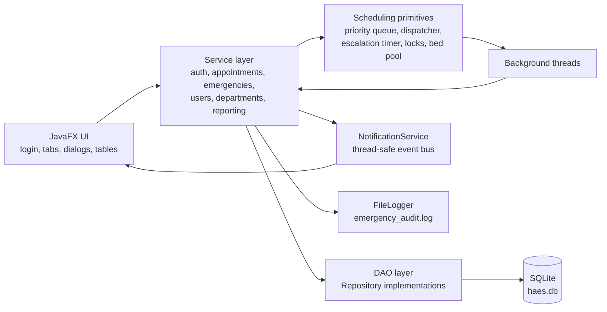
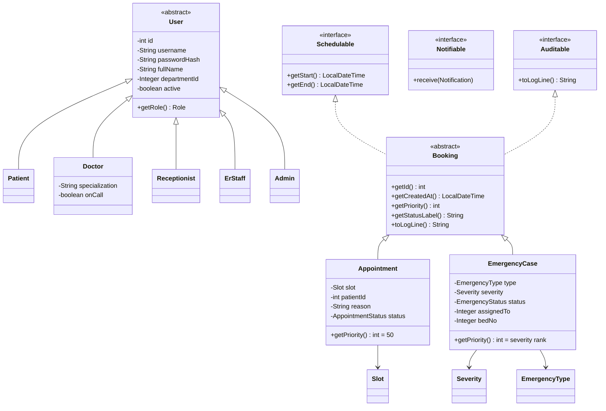
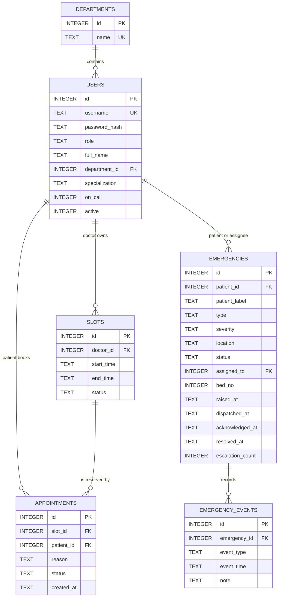
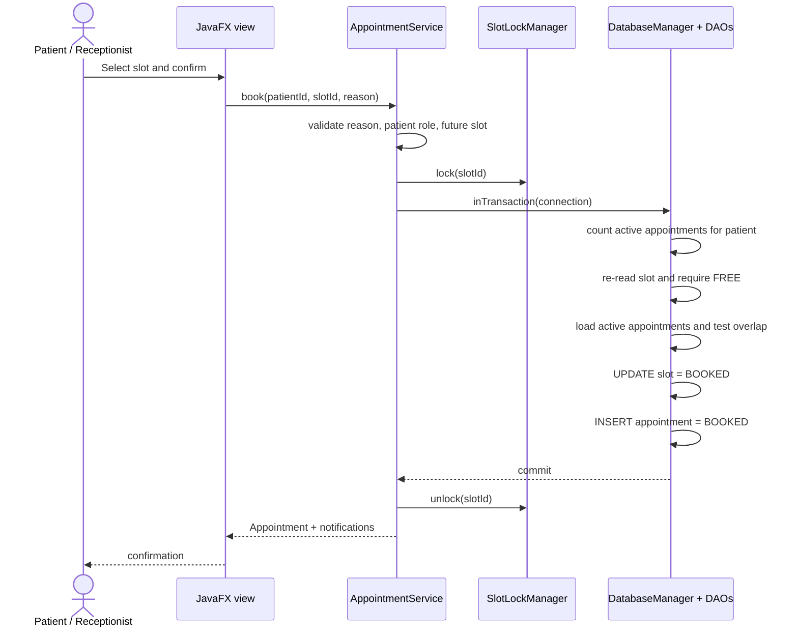
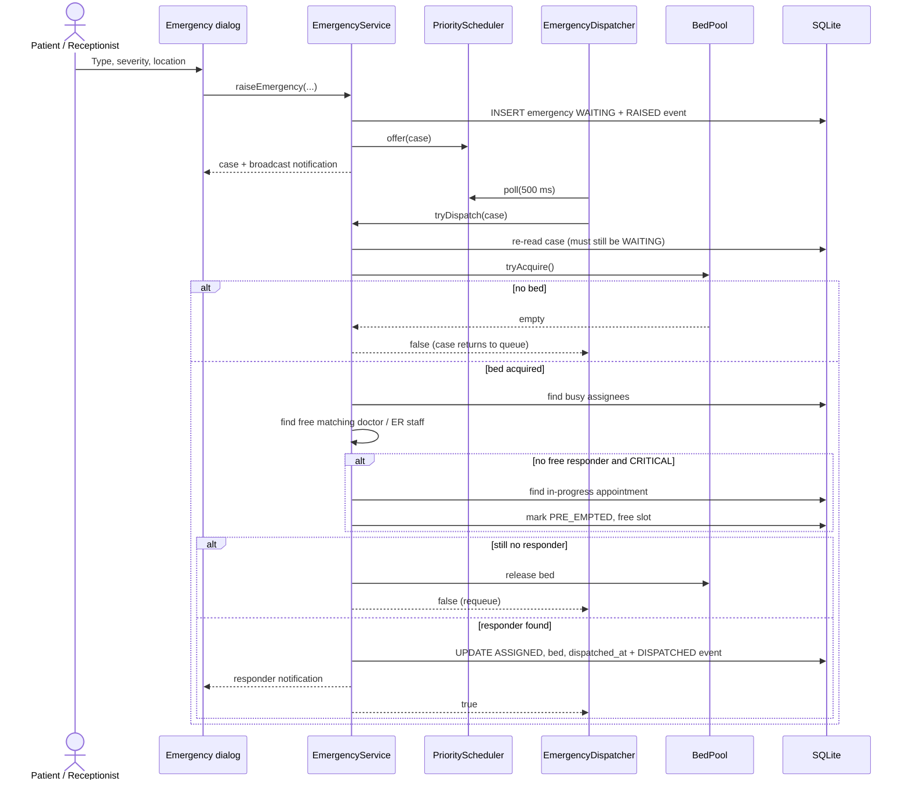
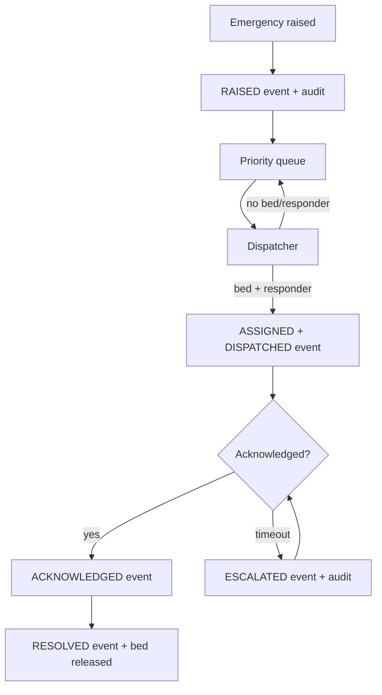

# HAES Design and Architecture

This document records the structure and engineering decisions behind HAES. It complements the requirements in the project brief and the test evidence in [TESTING.md](TESTING.md).

> HAES is an academic simulation using invented data. It is not a clinical system.

## 1. Architectural Style

HAES is a layered desktop application. JavaFX classes handle presentation and user interaction only; business rules live in services; scheduling primitives live in `scheduler`; all SQL lives in `dao`.



### Layer responsibilities

| Layer | Responsibility | Must not do |
| --- | --- | --- |
| `ui` | Build screens, validate form shape, call services, render notifications | Contain SQL or scheduling rules |
| `service` | Enforce business rules, coordinate transactions, publish notifications | Build JavaFX controls |
| `scheduler` | Threads, priority ordering, locks, semaphores, escalation scheduling | Know about screens |
| `dao` | Prepared statements, row mapping, schema initialization, transactions | Enforce role or booking policy |
| `model` | Domain state and small domain behaviour | Perform I/O |
| `util` | Cross-cutting helpers: validation, hashing, CSV, logging, `Result<T>` | Depend on JavaFX |
| `exception` | Typed failures that callers must handle | Leak raw `SQLException` to the UI |

## 2. Package Map

```text
com.hospital.haes
├─ Main                     JavaFX Application entry point
├─ model
│  ├─ User (abstract) → Patient, Doctor, Receptionist, ErStaff, Admin
│  ├─ Booking (abstract) → Appointment, EmergencyCase
│  ├─ Department, Slot, Notification, EmergencyEvent
│  ├─ interfaces: Schedulable, Notifiable, Auditable
│  └─ enums: Role, SlotStatus, AppointmentStatus, EmergencyType,
│            Severity, EmergencyStatus, NotificationLevel
├─ service
│  ├─ AuthService, UserService, DepartmentService
│  ├─ AppointmentService, EmergencyService
│  ├─ NotificationService, ReportingService
├─ scheduler
│  ├─ PriorityScheduler<T>, EmergencyDispatcher, EscalationTimer
│  ├─ SlotLockManager, BedPool
├─ dao
│  ├─ Repository<T,ID>, DatabaseManager
│  ├─ UserDao, DepartmentDao, SlotDao, AppointmentDao, EmergencyDao
│  └─ SampleData
├─ exception
│  ├─ SlotConflictException, InvalidBookingException
│  ├─ UnauthorizedActionException, ValidationException
│  └─ DatabaseOperationException
├─ util
│  ├─ Validator, PasswordHasher, CsvImporter, CsvExporter
│  ├─ FileLogger, Result<T>
└─ ui
   ├─ AppContext (composition root), MainWindow, LoginView
   ├─ EmergencyDialog, UiUtils
   └─ views: booking, availability, appointments, emergency board,
              waitlist, doctor schedule, reports, admin users/departments
```

`AppContext` is the composition root: DAOs and services are constructed once and injected into views. Views never construct database objects.

## 3. Domain Model



Key OOP choices:

- `User` is abstract with role subclasses; `getRole()` is polymorphic.
- `Booking` unifies the two kinds of work and declares `getPriority()`. `Appointment` returns a constant routine priority, while `EmergencyCase` returns its severity rank.
- `EmergencyCase.compareTo` is the dispatch policy: **severity rank first, arrival time second, id as a deterministic tie-breaker**.
- The interfaces keep concerns separate: scheduling time windows, notification delivery and audit formatting.

## 4. Database Design

The schema is created from `src/main/resources/db/schema.sql`. Timestamps are ISO-8601 text, which SQLite compares lexicographically in the same order as the original `LocalDateTime` values.



Integrity rules:

- `PRAGMA foreign_keys = ON` is executed on **every connection**, not just the first.
- `PRAGMA busy_timeout = 5000` avoids transient `SQLITE_BUSY` failures when a read overlaps a short write.
- `users.username` and `departments.name` are unique.
- `slots` has `UNIQUE (doctor_id, start_time)` and a `FREE`/`BOOKED` check.
- Appointment and user deletion is restricted by foreign keys when clinical records still reference them.
- Passwords are PBKDF2-HMAC-SHA256 hashes with a random 16-byte salt and 65,536 iterations.

## 5. Appointment Scheduling Design

### 5.1 Booking critical section



The first read is only a fast pre-check. The authoritative checks happen **inside the per-slot lock and inside the transaction**:

1. Active appointment count against the per-patient limit (default 3).
2. Fresh slot status must still be `FREE`.
3. The patient must not already have an overlapping active appointment.
4. `UPDATE slots ... WHERE id = ?` must affect one row.
5. Insert the appointment in the same transaction.

If any step fails, the transaction rolls back and the service throws `SlotConflictException` or `InvalidBookingException`. Because the slot row is re-read under the lock, two threads cannot both pass the check.

### 5.2 Reschedule, cancel and status changes

- Rescheduling locks **both** old and new slot ids in ascending order to avoid deadlock. Inside one transaction it inserts the replacement appointment, marks the old one `RESCHEDULED`, marks the new slot `BOOKED`, and frees the old slot.
- Cancelling locks the slot, marks the appointment `CANCELLED`, and frees the slot.
- Marking `COMPLETED` or `NO_SHOW` is restricted to the assigned doctor or an admin, and also frees the slot.
- Pre-emption changes the appointment to `PRE_EMPTED` and frees the slot; the appointment is added to a generic `PriorityScheduler<Appointment>` waitlist.

### 5.3 Validation and authorization

- Booking reasons are required, trimmed and capped at 250 characters.
- Past slots, unknown patients, non-patient bookings, invalid ranges and overlapping availability are rejected.
- Patients may manage only their own appointments; doctors only their own schedule; reception, ER staff and admins may manage appointments.
- The UI catches distinct exception types and shows different messages.

## 6. Emergency Dispatch Design

### 6.1 Queue ordering

`PriorityScheduler<EmergencyCase>` wraps a `PriorityBlockingQueue`. Ordering is defined by `EmergencyCase.compareTo`:

1. Severity rank: `CRITICAL` (0), `HIGH` (1), `MEDIUM` (2).
2. Earlier `raisedAt` first within a severity.
3. Lower id as a deterministic tie-breaker.

`PriorityScheduler` is generic over `T extends Schedulable & Comparable<T>`, so the same implementation also stores pre-empted appointments for the reschedule waitlist.

### 6.2 Raise → dispatch → acknowledge



The dispatcher is a daemon thread (`EmergencyDispatcherThread`). It polls with a timeout, retries a failed case after a short pause, and returns it to the priority queue so its rank is preserved. The synchronous `dispatchPendingNow()` path uses the same dispatch lock, which makes tests deterministic and gives the UI a “dispatch now” action.

### 6.3 Critical pre-emption

`findFreeResponder` explicitly skips a doctor who has an appointment in progress. If the case is `CRITICAL`, `findPreemptibleDoctor`:

1. First tries doctors whose specialization matches the emergency type.
2. Then tries any doctor (Critical overrides specialty matching).
3. Calls `AppointmentService.preEmptForEmergency`.
4. The appointment becomes `PRE_EMPTED`, its slot becomes `FREE`, it enters the reschedule waitlist, and its patient receives a `CRITICAL` notification.

Only Critical cases may pre-empt. High and Medium cases wait in the queue.

### 6.4 Escalation

`EscalationTimer` is a single-thread `ScheduledExecutorService` that runs `scanEscalations()` every second. A case is overdue when:

- status is `ASSIGNED` or `ESCALATED`,
- `acknowledged_at` is null,
- `dispatched_at <= now - ackTimeoutSeconds`.

For each overdue case the service:

1. Re-reads the current row.
2. Finds a free alternate responder, excluding the current assignee and anyone already assigned to an active case.
3. Reassigns and notifies the alternate, or broadcasts a Critical warning to the duty head if nobody is free.
4. Sets status `ESCALATED`, increments `escalation_count`, resets `dispatched_at`, and clears `acknowledged_at`.
5. Writes an `ESCALATED` event and an audit line.

The scan is `synchronized`, so timer ticks cannot overlap. Acknowledgment requires the assigned responder and writes an `ACKNOWLEDGED` event; resolution releases the bed and writes `RESOLVED`.

### 6.5 ER bed pool

`BedPool` combines three mechanisms:

- `Semaphore(capacity, fair)` enforces the number of free beds.
- `ConcurrentLinkedQueue<Integer>` hands out concrete bed numbers.
- `ConcurrentHashMap.newKeySet()` tracks occupied bed numbers so `release` is idempotent.

A bed is acquired before responder lookup. If no responder exists, the bed is released; this avoids holding a scarce bed while waiting for a doctor.

## 7. Threads and Event Flow

| Thread / executor | Purpose | Synchronisation |
| --- | --- | --- |
| JavaFX Application Thread | All UI updates | View refreshes are scheduled with `Platform.runLater` where needed |
| `EmergencyDispatcherThread` | Poll priority queue and dispatch | `dispatchLock`; database write lock; `BedPool` |
| `EscalationTimerThread` | Periodic acknowledgment scan | `synchronized scanEscalations()`; database write lock |
| Booking caller threads | Patient/reception actions | Per-slot fair `ReentrantLock`; database write lock |
| SQLite write transactions | Short, serialized writes | Fair `ReentrantLock` in `DatabaseManager` |



Notifications are published through a thread-safe `NotificationService` with a bounded history (200 entries). Views register a `Notifiable` listener and marshal updates onto the JavaFX thread. The audit log is append-only and synchronized per line.

## 8. Generics and Reuse

- `Repository<T, ID>` defines `save`, `findById`, `findAll`, `update`, `delete`; each DAO implements it.
- `Result<T>` wraps reporting success or a user-readable error, avoiding `null` checks scattered through the UI.
- `PriorityScheduler<T extends Schedulable & Comparable<T>>` is reused for emergencies and the appointment waitlist.
- `DatabaseManager.inTransaction(SqlWork<T>)` is a generic transaction template: the work returns any type and checked SQL failures become `DatabaseOperationException`.

## 9. Design Decisions and Trade-offs

| Decision | Why | Trade-off |
| --- | --- | --- |
| One coarse fair write lock | SQLite is a single-file database; serializing short writes eliminates lock errors and keeps integrity simple | Lower write throughput than a server database; acceptable for a desktop simulation |
| Per-slot locks on top of the DB lock | The lock makes check-then-insert atomic and keeps conflict handling cheap; the DB transaction is the final authority | Lock map grows with distinct slot ids; harmless at course scale |
| Bed before responder | Avoids reserving a doctor for a case that has nowhere to go | A failed responder lookup briefly reserves then releases a bed |
| In-memory queue rebuilt on start | Active `WAITING` cases survive restart; no separate queue table is needed | Queue order depends on persisted timestamps and severity |
| Pre-emption only for Critical | Matches the requirement and limits disruption to routine care | High cases may wait when every doctor is consulting |
| Programmatic JavaFX, no FXML | Keeps the project self-contained and makes role-specific composition explicit | More verbose UI code; no visual designer |
| PBKDF2 with per-password salt | Avoids plain-text passwords and demonstrates secure hashing | Slower login than a plain hash; still demo-grade authentication |

## 10. Requirement Traceability (Summary)

| Requirement group | Main implementation | Primary evidence |
| --- | --- | --- |
| FR-1…FR-3 accounts, roles, validation | `AuthService`, `UserService`, `DepartmentService`, `Validator` | `AuthServiceTest`, `AdminServiceTest`, `ValidationTest` |
| FR-4…FR-9 appointments | `AppointmentService`, `SlotDao`, `AppointmentDao`, `SlotLockManager` | `AppointmentServiceTest`, `ConcurrentBookingTest` |
| FR-10…FR-16 emergencies | `EmergencyService`, `PriorityScheduler`, `EmergencyDispatcher`, `EscalationTimer`, `BedPool` | `EmergencyServiceTest`, `BedPoolTest`, `EvaluationTest` |
| FR-17…FR-20 notifications, files, CSV | `NotificationService`, `FileLogger`, `CsvExporter`, `CsvImporter`, `ReportingService` | `CsvTest`, `AppContextTest` |
| NFR-1 concurrency | slot locks + transaction re-checks | 50-thread race test |
| NFR-2 responsiveness | priority dispatcher; measured in test | `EvaluationTest` (average/max latency printed and asserted under 1 s) |
| NFR-4 reliability | checked exceptions, startup error dialogs, rollback tests | `DatabaseFailureTest`, `Main` |
| NFR-5 integrity | foreign keys, prepared statements, transactions | `DatabaseFailureTest`, DAO review |
| NFR-6 maintainability | layered packages, composition root | package map above |

A detailed acceptance-criteria matrix is in [TESTING.md](TESTING.md).

## 11. Known Design Limitations

- No multi-process coordination beyond SQLite locking; the app is designed for one desktop instance.
- The emergency queue is memory-resident; a crash can lose queued-but-not-persisted dispatch intent, although active cases are reloaded from the database on startup.
- Bed numbers are simulation values, not linked to a physical ward map.
- Escalation “duty head” is represented by a broadcast notification, not a separate user role.
- UI automation is out of scope; JavaFX interaction is verified manually.
